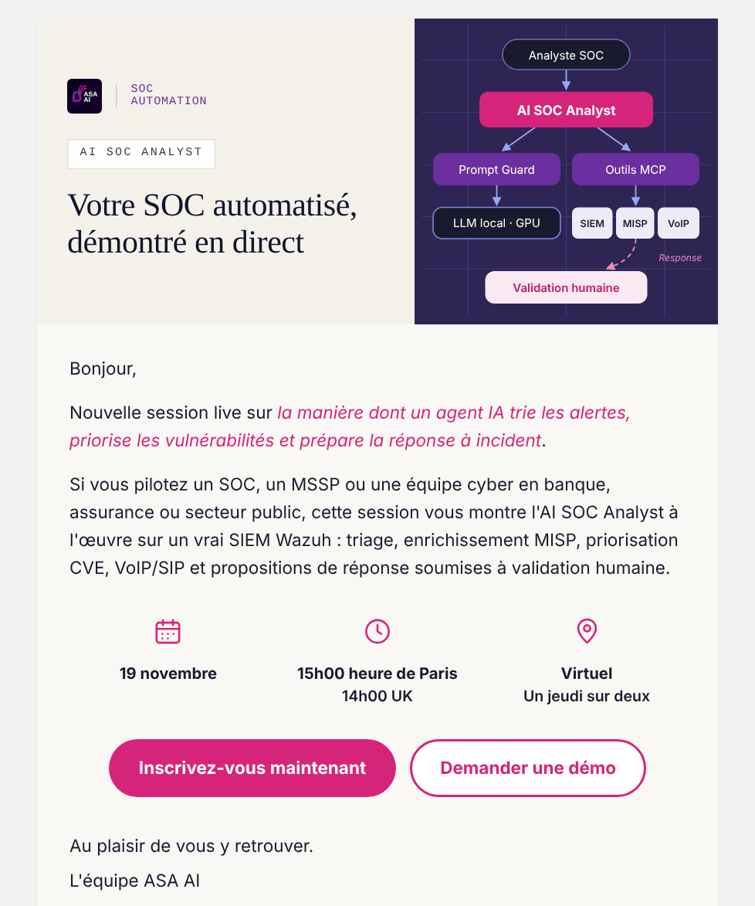
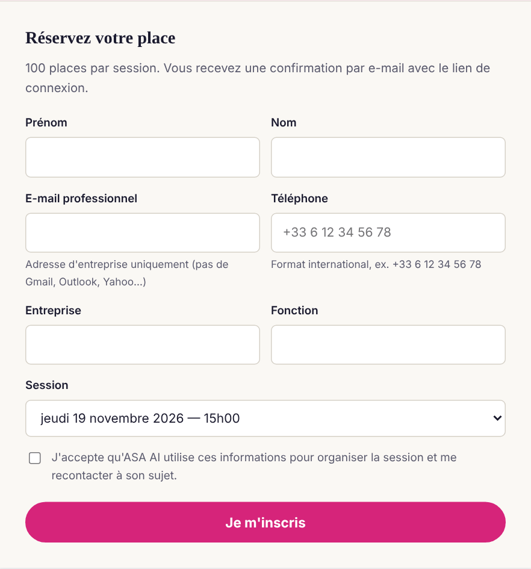
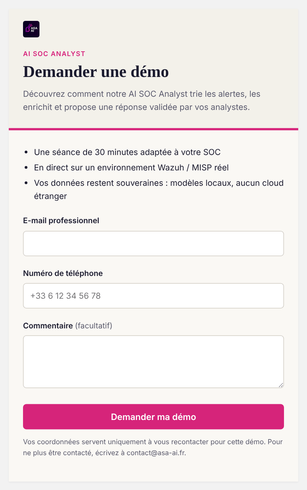

[English](README.md) · **Français**

# ASA AI — AI SOC Analyst, démo en direct

Une séance en direct de 45 minutes pour voir comment un agent IA **trie les alertes, priorise les vulnérabilités et prépare la réponse à incident** sur un vrai environnement SOC (SIEM Wazuh, MISP, VoIP/SIP), chaque proposition de réponse restant soumise à **validation humaine**.

> Édité par **ASA AI** — automatisation SOC et sécurité des services VoIP.
> Contact : **<contact@asa-ai.fr>** · [www.asa-ai.fr](https://www.asa-ai.fr)

**→ S'inscrire : [khemegha.github.io/asa-ai-live](https://khemegha.github.io/asa-ai-live/)**

**→ Démo privée : [khemegha.github.io/asa-ai-live/demo.html](https://khemegha.github.io/asa-ai-live/demo.html)**

---

## Aperçu

**Une page, deux parcours — rejoindre la prochaine séance en direct, ou réserver une démo privée pour votre équipe.**

### 1. La séance en direct

Un jeudi sur deux à **15h00, heure de Paris** (14h00 UK), en ligne. Pensée pour les équipes SOC, les MSSP et les équipes cyber de la banque, de l'assurance et du secteur public.

**Au programme (45 min)**

- Triage automatique des alertes Wazuh et corrélation
- Priorisation des vulnérabilités critiques par machine (CVE + CVSS)
- Enrichissement Threat Intelligence via MISP
- Détection des menaces VoIP / SIP et de la fraude téléphonique
- Réponse à incident avec approbation humaine et journal d'audit
- Questions / réponses en direct

### 2. Réservez votre place

**100 places par session.** Vous recevez une confirmation par e-mail avec le lien de connexion.

### 3. Demandez une démo privée

Une séance de 30 minutes adaptée à votre SOC, en direct sur un environnement Wazuh / MISP réel. Vos données restent souveraines : modèles locaux, aucun cloud étranger.

---

## Accès

1. Ouvrez **[khemegha.github.io/asa-ai-live](https://khemegha.github.io/asa-ai-live/)** — la page s'affiche dans la langue de votre navigateur (français, anglais ou espagnol).
2. Inscrivez-vous à une séance, ou cliquez sur **Demander une démo**.
3. Un **e-mail professionnel** et un **numéro de téléphone** sont requis (les messageries gratuites ou personnelles ne sont pas acceptées).
4. Notre équipe vous recontacte pour confirmer.

---

## Confidentialité

Vos coordonnées servent uniquement à organiser la séance ou la démo et à vous recontacter à ce sujet. Pour ne plus être contacté, écrivez à **<contact@asa-ai.fr>**.

---

## Support

**<contact@asa-ai.fr>** — questions, démos privées, projets pilotes.

© ASA AI. Tous droits réservés.
