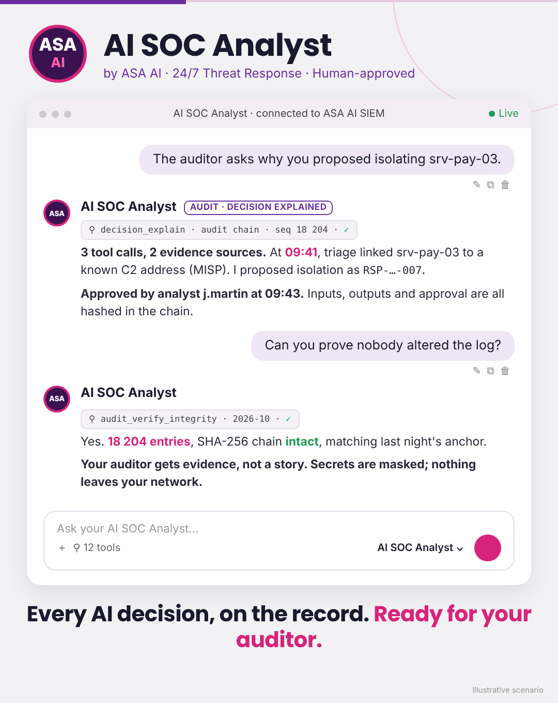
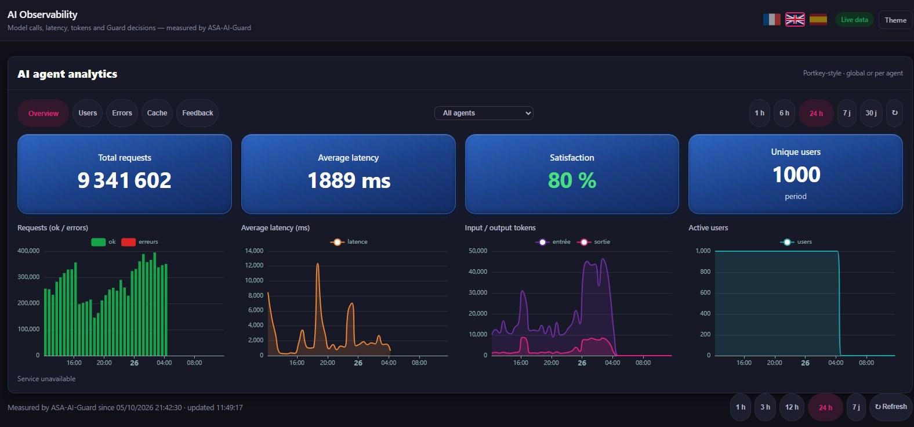
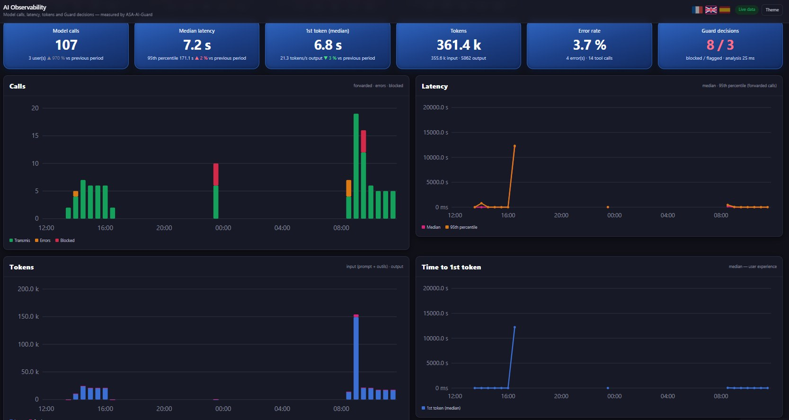
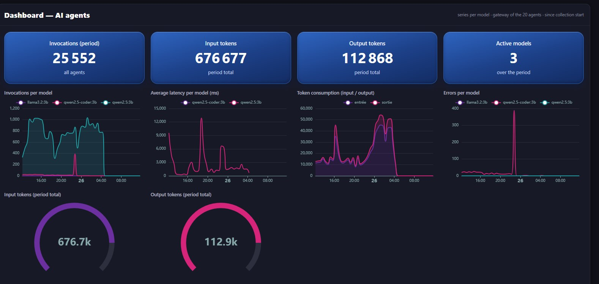
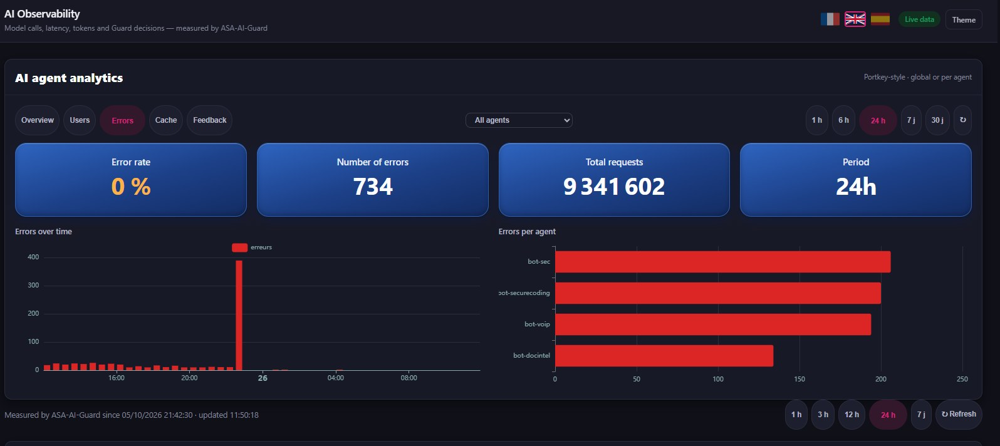
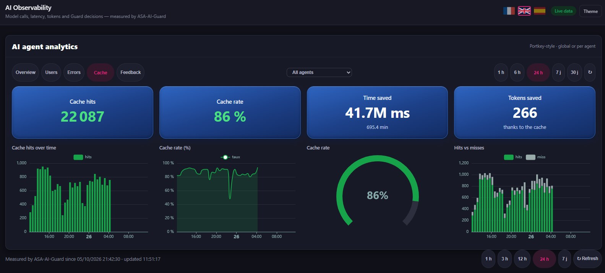
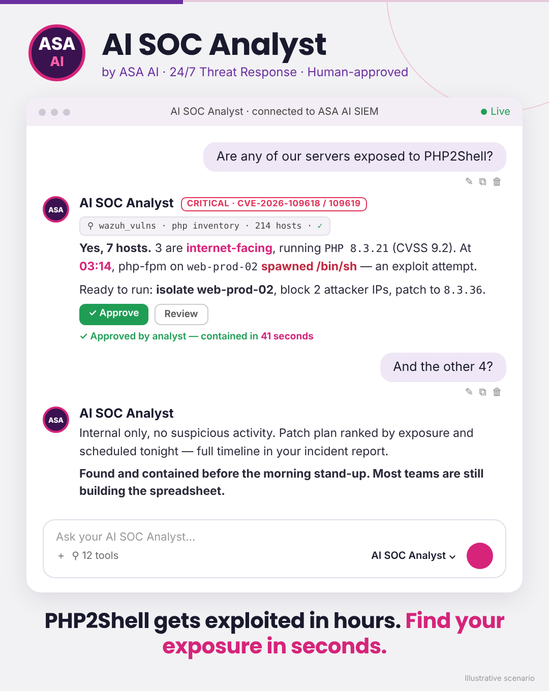

# ASA AI · SENTINEL AI & AI SOC Analyst

## 📜 Every AI decision, on the record. Ready for your auditor.

Regulators don't ask whether your SOC uses AI. They ask **who decided what, based on which evidence, and whether you can prove it.** AI SOC Analyst answers all three, in seconds.

- 📝 **Record**: every tool call the agent makes is logged (user, tool, parameters, sources, result), with secrets masked
- 🔗 **Chain**: entries are linked in a SHA-256 hash chain and anchored daily. Change one line and the chain breaks, visibly
- 💬 **Explain**: ask "why did you propose this?" and get the evidence trail behind the decision
- ✅ **Approve**: containment is proposed, never executed alone. Every approval is recorded with the analyst's name
- ⏱️ **Regulatory clocks** *(early access)*: NIS2, DORA and GDPR notification deadlines tracked when an incident turns serious

Built for banks, insurers and the public sector · On-prem · Nothing leaves your network

**AI does the grind. Your analysts make the call. Your auditor sees all of it.**

### 👉 [Request a demo with your toughest audit questions](https://demo.asa-ai.fr/demo.html)

Full page: [demo.asa-ai.fr/compliance.html](https://demo.asa-ai.fr/compliance.html)

Illustrative scenario.

---

## 👁️ Your AI agents are in production. Can you see what they're doing?

**SENTINEL AI Observability** gives your security and platform teams one live view of every AI agent you run: every prompt, every token, every slow answer, every blocked attack. On your own infrastructure.

| | |
|---|---|
| 🛡️ **Security** | Every call goes through ASA-AI-Guard. Prompts blocked or flagged are counted and timestamped for your audit trail. |
| 🧠 **Models** | Invocations, latency, tokens and errors per model, across the whole agent gateway. |
| 🚨 **Reliability** | Errors over time and per agent: a spike becomes a ticket with a name, a time and a scope. |
| 💰 **Cost & speed** | Semantic cache hits, hit rate, time and tokens saved, in plain numbers. |
| 👥 **Adoption** | Unique users, active users and requests per user. |
| ⭐ **Quality** | Thumbs up / thumbs down and satisfaction rate, tracked like any other KPI. |

**In our lab, over 24 hours:** 9.3M agent requests tracked · 86% cache hit rate · 80% user satisfaction · 20 agents behind one gateway.
Lab figures, including load testing. Your numbers will differ: that's what the demo is for.

On-prem · Works with your existing LLMs and agents · Built for regulated environments (DORA, NIS2, GDPR, EU AI Act)

**You can't secure what you can't see.**

### 👉 [Request a demo on your own AI agents](https://demo.asa-ai.fr/demo.html)

Full tour: [demo.asa-ai.fr/sentinel-observability.html](https://demo.asa-ai.fr/sentinel-observability.html)

---

## ⚠️ PHP2Shell gets exploited in hours. Find your exposure in seconds.

**PHP2Shell** (CVE-2026-109618 & CVE-2026-109619) is a pre-auth remote code execution in the PHP core, rated **CVSS 9.2**. Every PHP version from 5.4 to 8.5.11 is affected. It leaked before the patch, exploit attempts started before the disclosure, and they reached millions within a day.

The only question that matters now: **which of your servers are exposed, and is anyone already inside?**

With **AI SOC Analyst**, you ask it in plain English and get the answer in seconds:

- 🔍 **Find**: every vulnerable PHP host across your fleet, with its exact version
- 🎯 **Rank**: internet-facing and business-critical hosts first, one clear patch plan (8.5.12 / 8.4.27 / 8.3.36 / 8.2.35)
- 🚨 **Detect**: php-fpm / php-cgi spawning shells, the telltale sign of exploitation
- ✅ **Contain**: isolation, IP blocking and patching proposed. Nothing runs until your analyst clicks Approve. Every step is logged.

On-prem · Fully auditable · Built for regulated environments (DORA, NIS2, GDPR)

**AI does the grind. Your analysts make the call.**

### 👉 [Request a demo on your own environment](https://demo.asa-ai.fr/demo.html)

Full page: [demo.asa-ai.fr/php2shell.html](https://demo.asa-ai.fr/php2shell.html)

Illustrative scenario.

---

## AI SOC Analyst Live

Registration page for the live demo of the ASA AI **AI SOC Analyst**, at 3:00 pm (Paris time).

**→ https://demo.asa-ai.fr/**

100 seats per session. Contact: contact@asa-ai.fr · [www.asa-ai.fr](https://www.asa-ai.fr)
