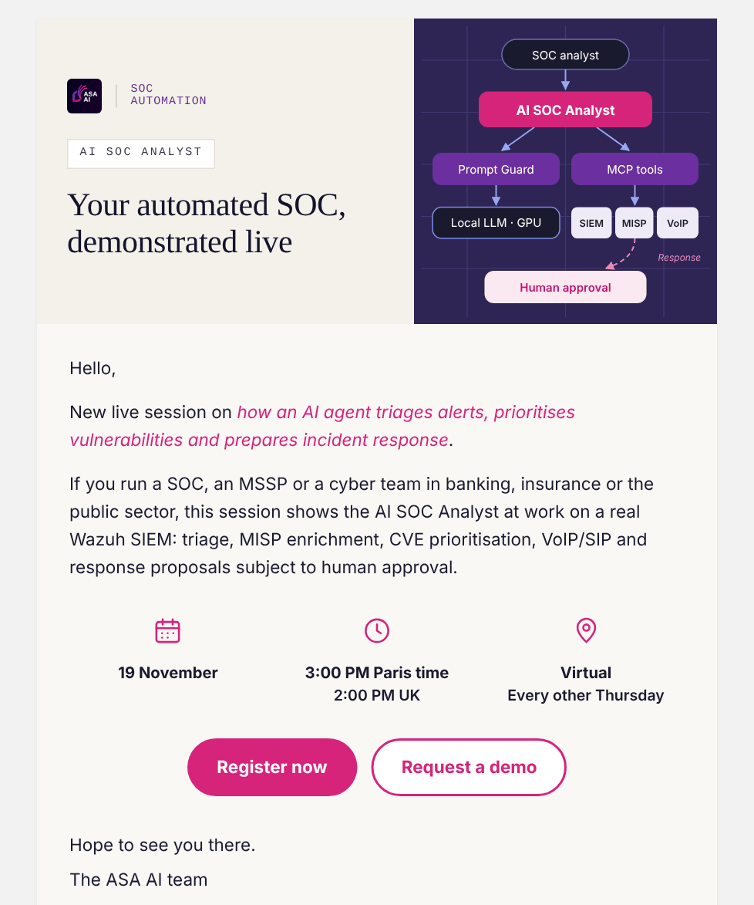
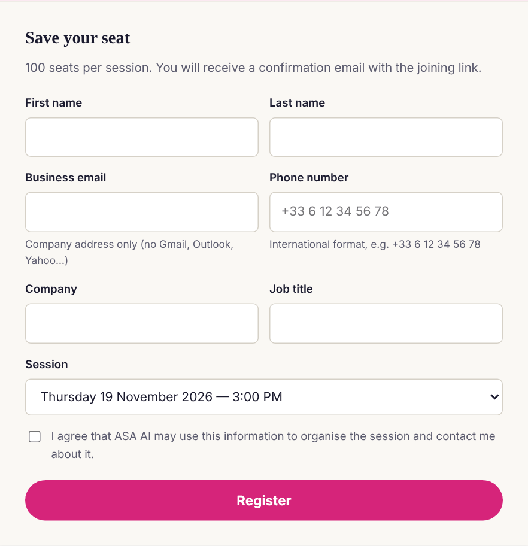
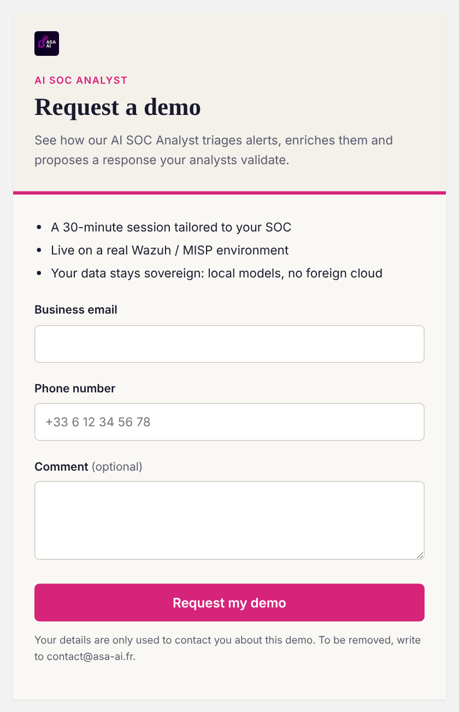

**English** · [Français](README.fr.md)

# ASA AI — AI SOC Analyst, live demo

A live, 45-minute session showing how an AI agent **triages alerts, prioritises vulnerabilities and prepares incident response** on a real SOC environment (Wazuh SIEM, MISP, VoIP/SIP), with every response proposal subject to **human approval**.

> Published by **ASA AI** — SOC automation and VoIP service security.
> Contact: **<contact@asa-ai.fr>** · [www.asa-ai.fr](https://www.asa-ai.fr)

**→ Register: [khemegha.github.io/asa-ai-live](https://khemegha.github.io/asa-ai-live/)**

**→ Private demo: [khemegha.github.io/asa-ai-live/demo.html](https://khemegha.github.io/asa-ai-live/demo.html)**

---

## Preview

**One page, two paths — join the next live session, or book a private demo for your team.**

### 1. The live session

Every other Thursday at **3:00 pm Paris time** (2:00 pm UK), online. Built for SOC teams, MSSPs and cyber teams in banking, insurance and the public sector.

**Agenda (45 min)**

- Automated triage and correlation of Wazuh alerts
- Prioritisation of critical vulnerabilities per host (CVE + CVSS)
- Threat Intelligence enrichment with MISP
- VoIP / SIP threat and telephony fraud detection
- Incident response with human approval and audit trail
- Live Q&A

### 2. Save your seat

**100 seats per session.** You receive a confirmation e-mail with the joining link.

### 3. Request a private demo

A 30-minute session tailored to your SOC, live on a real Wazuh / MISP environment. Your data stays sovereign: local models, no foreign cloud.

---

## Access

1. Open **[khemegha.github.io/asa-ai-live](https://khemegha.github.io/asa-ai-live/)** — the page displays in your browser's language (English, French or Spanish).
2. Register for a session, or click **Request a demo**.
3. A **business e-mail** and a **phone number** are required (free and personal mailboxes are not accepted).
4. Our team contacts you to confirm.

---

## Privacy

Your details are only used to organise the session or the demo and to contact you about it. To be removed, write to **<contact@asa-ai.fr>**.

---

## Support

**<contact@asa-ai.fr>** — questions, private demos, pilot projects.

© ASA AI. All rights reserved.
